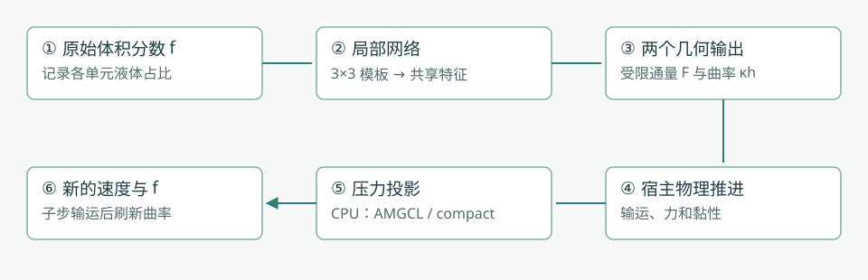
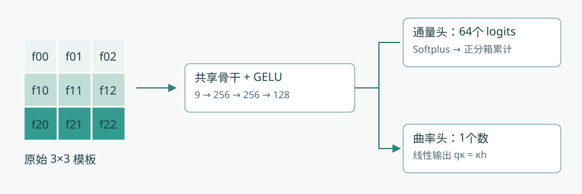
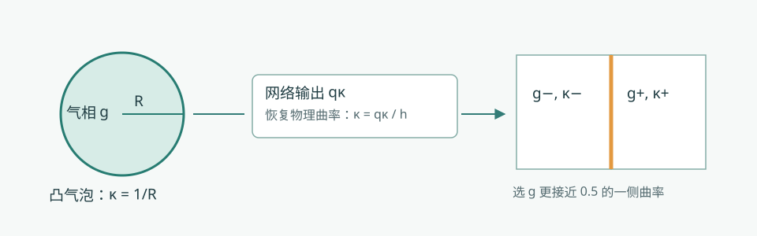
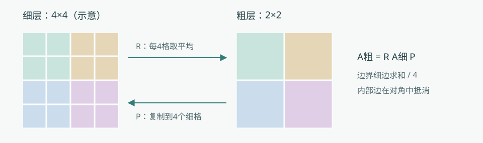
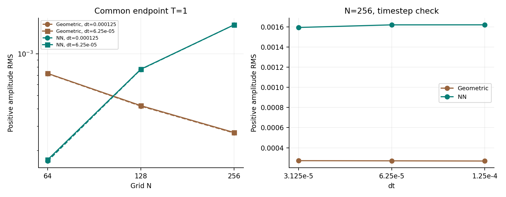

# 从体积分数到两相流：PLIC-VOF 详细方法

这份说明从“一个格子里有多少液体”开始，依次说明训练数据、网络通量、曲率、表面张力、压力求解和实验验证。公式采用 Overleaf 方法快照中的定义；重训与补充实验另行标明。阅读时可以先看图和例子，再看推导。

<strong>先记住四个角色。</strong>体积分数记录液体有多少；通量决定液体移到哪里；曲率帮助计算表面张力；压力投影让速度满足不可压缩条件。网络只负责其中的局部通量与曲率，完整流体运动仍由数值求解器推进。

## 1. 整体路线：我们究竟计算什么？

VOF 是 Volume of Fluid，即体积分数法。传统 PLIC（分片线性界面重构）通常先在混合单元内重建一条直线，再计算穿过网格面的相体积。本项目的神经路径直接从局部体积分数预测通量和曲率；运行时不重新构建 PLIC 界面，也不启用几何锐化。PLIC-VOF 是项目名称，不表示神经路径仍然逐格执行传统 PLIC。

图1｜实线框是实际方法组成。通量与曲率共享网络权重，但宿主分开调用；压力后端在 CPU 上运行。示意图概括依赖关系，具体更新时间见第8节。

本方法限定为二维、均匀正方形网格。每格边长为 $h$，面积为 $h^2$。二维的“体积”应理解为面积；能量按单位出平面厚度解释。

| 符号 | 意思 | 在程序里的位置或单位 |
|---|---|---|
| $f$、$g=1-f$ | 液相、气相体积分数 | 无量纲，单元中心；$f=0$ 全气，$f=1$ 全液 |
| $\boldsymbol u$、$p$ | 速度、压力 | 法向速度在网格面，压力在中心，MAC 交错网格 |
| $\Delta t$、$\delta t$ | 流体时间步、VOF 子步 | 子步用于使输运满足其步长约束 |
| $C$ | 面速度扫过的单元宽度比例 | $C=|u_f|\delta t/h$，本地公式要求 $0\le C\le1$ |
| $F$、$\Phi$ | 无符号、带符号相通量 | 均按单元面积归一化；实际相面积为 $Fh^2$ |
| $R_\theta$ | 流出相占供体相总量的比例 | $F_{\rm raw}=f_cR_\theta$，不是扫掠带的平均液相率 |
| $q_\kappa$、$\kappa$ | 无量纲曲率、物理曲率 | $q_\kappa=\kappa h$；$\kappa$ 单位为长度的倒数 |
| $q$ | 压力线性系统中的缩放未知量 | $q=p\Delta t/h$，与 $q_\kappa$ 是两个不同量 |

## 2. 物理方程：网络没有替代哪些工作？

不可压缩条件、液相输运和动量方程分别为：

$$\nabla\cdot\boldsymbol u=0,\qquad \partial_t f+\nabla\cdot(f\boldsymbol u)=0.$$

$$\rho(\partial_t\boldsymbol u+\boldsymbol u\cdot\nabla\boldsymbol u)=-\nabla p+\nabla\cdot[\mu(\nabla\boldsymbol u+\nabla\boldsymbol u^T)]+\rho\boldsymbol a+\boldsymbol s_\sigma.$$

第一式要求一个单元流入和流出的总体积平衡。第二式追踪液体。动量方程右侧依次是压力、黏性、重力等体力与表面张力。网络的两个输出分别参与液相输运和表面张力计算。

物性采用一个平滑副本，降低物性跳跃直接进入离散计算时的突变：

$$\bar f_i=\frac12f_i+\frac18(f_E+f_W+f_N+f_S),\quad \rho_i=\rho_g+(\rho_l-\rho_g)\bar f_i,\quad \mu_i=\mu_g+(\mu_l-\mu_g)\bar f_i.$$

边界缺失邻居用中心值补齐。这里的平滑只用于密度和动力黏度；保存的 $f$ 和网络输入仍使用原始体积分数。材料平滑、网络输入和界面锐化是不同操作。

## 3. 训练数据：标签怎样得到？

训练使用解析合成几何。它教网络回答局部几何问题，不使用整段真实流体轨迹作为监督，也没有端到端求解 Navier–Stokes 的训练损失。

1. **生成局部几何。**课程记录使用局部三次函数界面 $y=H(x)$，变化位置、斜率与弯曲程度；另有原始合成样本回放。
2. **积分得到9个输入。**把几何与九个单元分别求交并积分，获得原始 $3\times3$ 体积分数。
3. **积分得到通量标签。**在向右流出的标准方向，取中心格右侧宽为 $Ch$ 的扫掠带，计算带内相面积 $A_{\rm swept}$。
4. **计算曲率标签。**找到中心格内距离其中心最近的界面点，在这个点计算解析曲率。它不是格心外推值，也不是整段界面的弧长平均。
5. **做有标签的增广。**相互补把 $f$ 换成 $1-f$ 并相应改变曲率符号；转置样本使用解析横向通量，不能简单把原方向通量标签原样搬过来。
6. **按几何分组切分。**同一基础几何的相关样本放在同一组，以免相似样本跨入训练与验证；按验证指标挑选 checkpoint。

$$f_{ij}=\frac{1}{h^2}\int_{\Omega_{ij}}\boldsymbol1_{\rm phase}\,dA,\qquad F^*=\frac{A_{\rm swept}}{h^2},\qquad R^*=\frac{F^*}{f_c}.$$

这里 $\boldsymbol1_{\rm phase}$ 是相内为1、相外为0的指示函数；$R^*$ 用于有相含量的训练样本。比如 $f_c=0.6$，扫掠带带走单元面积的0.12，则 $F^*=0.12$、$R^*=0.2$：供体内20%的液体流出。

对于前景位于图像函数下方的约定：

$$\kappa^*=-\frac{H''(x_*)}{[1+H'(x_*)^2]^{3/2}},\qquad q_\kappa^*=h\kappa^*.$$

这里 $x_*$ 对应上述最近界面点。相互补时解析曲率反号。九个面积平均数不能唯一确定格内界面，因此学习的是特定训练分布下的局部近似；不能声称任意几何都可由九个数精确恢复。

## 4. 共享网络：九个数如何变成两个答案？

图2｜九宫格是原始体积分数。先把流出方向变为“向右”，再应用共享骨干。64个正分箱描述相量在扫掠方向上的分布，单独的线性头给出无量纲曲率。示意色块不代表某次实验预测。

最终模型的结构是 $9\to256\to256\to128$，每个隐藏层后使用 GELU 激活；两个线性输出头分别为 $128\to64$ 和 $128\to1$，共109,633个可训练标量。输入没有坐标，也没有统计标准化。Courant 数 $C$ 不进入共享骨干，而在后续分箱积分时使用。

推理先把供体模板旋转或反射到向右流出方向。模型还对原模板 $S$ 和上下行交换模板 $\mathcal RS$ 分别计算并平均。这一上下反射属于推理时结构性约束；相互补、90度旋转关系主要靠损失鼓励，不能说它们在推理时严格满足。

## 5. 通量：先保证正性，再保证装得下

### 5.1 64个正分箱的直观意思

把中心格沿流出方向分为64条。每条有一个严格为正的权重。$C$ 增大时，扫过更多条带，累计带走的相量便不会减少。

$$m_j(S)=\frac12\sum_{T\in\{S,\mathcal RS\}}[\operatorname{softplus}(z_j(T))+10^{-6}],\qquad j=0,\ldots,63.$$

$$w_j(C)=\operatorname{clip}(64C-j,0,1),\qquad R_\theta(S,C)=\frac{\sum_{j=0}^{63}w_j(C)m_j(S)}{\sum_{j=0}^{63}m_j(S)},\qquad F_{\rm raw}=f_cR_\theta.$$

Softplus 把任意实数变成正数；$10^{-6}$ 保证最小正量。$w_j$ 表示第 $j$ 个条带被扫过多少，未扫过为0，完整扫过为1，部分扫过则线性取值。条带编号从流出面开始理解。分母对64条的总权重归一化，所以 $C=0$ 时 $R=0$，$C=1$ 时 $R=1$。

### 5.2 为什么还要做容量投影？

扫过的条带面积只有 $Ch^2$；即使供体有很多液体，也不能把比条带更大的液体面积塞进去。另一侧留下的液体，也要装得进未扫过面积 $(1-C)h^2$。

$$L=\max(0,f_c+C-1),\qquad U=\min(f_c,C),\qquad F_\theta=\operatorname{clip}(F_{\rm raw},L,U).$$

$$0\le F_\theta\le f_c,\qquad F_\theta\le C,\qquad 0\le f_c-F_\theta\le1-C.$$

举例：$f_c=0.6$、$C=0.3$，假设网络给 $R=0.7$，则原始通量为0.42。容量上限是0.3，下限是0，所以最终通量为0.3；留下0.3的液体，未扫过部分容量为0.7。若 $f_c=0.9$、$C=0.3$，下限为0.2：至少要带走0.2，才能让剩余液体装进0.7的空间。

<h3>动手试一试：拖动扫掠宽度</h3>
这是教学用正分箱分布，不是训练模型输出。保持模板对应的中心含量固定，观察通量随 C 的变化。
<label>中心液相率 fc <input id="fc" type="range" min="0.002" max="0.998" step="0.001" value="0.6"><output id="fc-out"></output></label><label>Courant 数 C <input id="courant" type="range" min="0" max="1" step="0.001" value="0.3"><output id="c-out"></output></label><svg id="bin-demo" viewBox="0 0 760 190" role="img" aria-label="64个正分箱中被扫过的部分"></svg>

固定 $S$ 时，每个正分箱的累计量单调不减；容量上下界也单调不减，所以投影后的通量对 $C$ 仍单调不减。这保证的是**合格模板上的局部通量性质**，不是完整两方向推进的全局最大值原理，也不是对九个输入分数的整体单调性。

### 5.3 近纯单元怎样处理？

| 中心体积分数 | 实际分支 | 需要记住的区别 |
|---|---|---|
| $0.002\le f_c\le0.998$ | 调用网络并施加容量限制 | 两个端点都允许推理；邻居不按此门限截断 |
| $f_c<0.002$ | 采用空相通量 | 没有调用几何重构作为后备 |
| $f_c>0.998$ | 采用满相通量，大小为 $C$ | 将近满单元当作满相计算通量 |

这个门控不把已保存的 $f$ 自动改为0或1。例如 $f=0.001$ 被跳过推理，仍可能作为低含量尾迹留在场中。上述局部容量定理也不直接适用于把近满单元视为满相的旁路。

## 6. 输运更新：每个面只记一笔账

相邻两个格子使用同一个面通量：从左格扣除多少，就给右格加上多少。带符号通量为 $\Phi_f=\operatorname{sign}(u_f)F_\theta$。

在每个 VOF 子步开始先固定压缩指示量 $\chi_i=\boldsymbol1[f_i\ge1/2]$。对方向 $d$ 的扫掠为：

$$f_i^{(d)}=f_i^{\rm in}-(\Phi_{i+\frac12e_d}-\Phi_{i-\frac12e_d})+\chi_i\frac{\delta t}{h}(u_{i+\frac12e_d}-u_{i-\frac12e_d}).$$

1. 用扫掠开始时的场提取模板，决定各面的供体、流出方向和 $C$。
2. 每个面计算一次带符号通量，供相邻单元共享。
3. 计算上式中的通量差和方向压缩项。
4. 每次扫掠后做端点清理：低于 $10^{-10}$ 设为0，高于 $1-10^{-10}$ 设为1，有限越界值也被清理；非有限数报错。
5. 执行另一方向；相邻子步轮换 x–y 和 y–x 顺序。一个子步内两个方向使用同一份固定的 $\chi_i$。

清理之前，内部面通量在全局求和时抵消；若面速度严格离散无散，两个方向的压缩项也相互抵消。这解释了条件性的守恒结构。实际清理可能改变相面积，所以最终必须测量面积漂移，不能从“输出都在0到1之间”推出“没有发生裁剪且精确守恒”。$10^{-10}$ 清理阈值和0.002推理门限相差很多，作用也不同。

## 7. 曲率与表面张力：弯曲如何改变速度？

图3｜圆越小，曲率越大。曲率头预测 κh，宿主除以 h 恢复物理单位；每个面的力使用两侧中更接近混合状态的那个单元曲率。图中气泡和网格位置为教学示意。

$$q_\kappa=\kappa h,\qquad \kappa=\frac{q_\kappa}{h}.$$

例如 $h=0.01$、网络输出 $q_\kappa=0.04$，则物理曲率为4；对于半径0.25的二维圆，曲率也是 $1/R=4$。网格加密时同一个物理圆的 $\kappa$ 应保持4，但 $q_\kappa$ 随 $h$ 减小。这说明无量纲输出本身不等于网格一致性，仍要对固定物理形状重新积分并验证。

曲率头是无界线性输出，不保证预测正负号或大小一定正确。它也采用上下反射平均，不依赖 $C$；调用共同模型接口时给 $C=0$。

**相的约定必须一致。**动力学保存的是液相 $f$，但曲率使用 $g=1-f$。模型对“所表示相的凸区域”取正曲率，因此宿主实际得到凸气相为正的曲率，不再额外翻转符号。对不在 $[0.002,0.998]$ 的中心气相率，曲率设零，没有邻居延拓。

$$ (s_\sigma)_f=\sigma\kappa_{\rm sel}\frac{g_+-g_-}{h}.$$

其中 $\sigma$ 是表面张力系数；$\kappa_{\rm sel}$ 从两侧 $g$ 更接近0.5的单元选取。距离相等时选 plus 侧，NaN 曲率按0处理。这里没有对两侧曲率做算术平均。门控和这个二选一规则都有离散切换，局部曲率的微小变化可能通过选择与力反馈影响长时动力学。

输运模板边界采用最近单元延拓；曲率先同样提取，再在场景提供时用显式 ghost 分数覆盖域外项。不能把所有算例都描述成周期边界或完全相同的 halo。

## 8. 一个完整流体时间步，先后顺序是什么？

下面描述常规推进路径；启动阶段还有专门的投影和黏性处理。曲率缓存更新时刻也属于方法的一部分。

1. **更新物性：**由当前 $f$ 计算 $\bar f$、密度和黏度。
2. **准备动量输运速度：**动量对流启用时，先预测并投影输运速度，用于动量对流。
3. **计算力与黏性：**施加重力、已缓存曲率对应的表面力以及宿主原有黏性离散，形成待投影速度。
4. **主压力投影：**求解压力并修正面速度，使其接近离散无散。
5. **追赶 VOF 时钟：**必要时执行多个输运子步；每个子步按第6节做两方向扫掠。
6. **刷新曲率：**在这些 VOF 子步之后用更新的气相分数计算曲率，供后续力计算使用。
7. **保存实际时钟和诊断：**记录面积、速度、压力、求解残差和各阶段耗时。

因此，一个流体时间步可能包含不止一次压力求解。共享骨干也不意味着通量和曲率在整个求解器中只做一次联合前向。更换 AMGCL 与 compact 后端时，以上宿主流程和固定网络保持一致。

## 9. 压力投影：怎样让流体不被凭空压缩？

### 9.1 从速度散度形成线性系统

把未投影面速度记为 $\boldsymbol u^*$。相邻单元间系数为两侧密度倒数的均值：

$$w_{ij}=\frac12(\rho_i^{-1}+\rho_j^{-1}),\quad q_i=p_i\frac{\Delta t}{h},\quad (Aq)_i=\sum_{j\in\mathcal N(i)}w_{ij}(q_i-q_j)=b_i,\quad b_i=-\sum_{f\in\partial i}s_{if}u_f^*.$$

$$u_f^{n+1}=u_f^*-w_{ij}(q_j-q_i),\qquad p_i=q_i\frac{h}{\Delta t}.$$

$s_{if}$ 是相对单元的向外方向符号。右端 $b$ 描述当前净流出，压力差修正各个面速度。由于采用了缩放未知量 $q$，这里不再显式写一个 $h^{-2}$。没有外部邻居的边不添加系数；法向边界速度在投影前后归零。

### 9.2 为什么固定一个压力值？

压力加一个常数不改变速度，因此矩阵有常数零空间。compact 固定 $q_0=0$：把第0行和列耦合都移除、对角设1、$b_0=0$，但保留邻居原有对角系数。正密度和连通网格下，这得到对称正定系统，适合 PCG。

$$x^TAx=\sum_{\{i,j\}}w_{ij}(x_i-x_j)^2.$$

每条无向边只算一次。固定常数自由度后，非零自由向量具有正能量。原 AMGCL 路径只替换第0行，保留第0列的其他条目；完整存储矩阵因此不是对称的，尽管固定分量为零时对应相同的自由方程。两种存储矩阵不能称作逐项相同。

### 9.3 三个数组与精确粗化

图4｜把相邻细格归为一个粗格。延拓把粗值复制回去，限制对细值取平均。粗算子必须由 RAP 得到，不能随意用另一套近似系数替换。

每层用三个 double 系数数组存储：对角 $d$，以及正 x、正 y 方向的负非对角系数 $e^x,e^y$。反向连接复用邻居数组中的条目，不为每条边重复存储一般 CSR 索引。工作向量和最粗层直接求解仍需额外内存。

$$ (Ax)_i=d_ix_i+e_i^xx_{i+e_x}+e_{i-e_x}^xx_{i-e_x}+e_i^yx_{i+e_y}+e_{i-e_y}^yx_{i-e_y}.$$

每个偶数维度独立减半，形成 $2\times2$、$2\times1$ 或 $1\times2$ 聚合；同一层的聚合细格数 $m$ 相同。设 $P$ 为复制延拓，则：

$$P_{iI}=\boldsymbol1[i\in I],\qquad R=\frac1mP^T,\qquad A_c=RA_fP.$$

$$ d_I^c=\frac1m\left(\sum_{i\in I}d_i^f+2\sum_{\{i,j\}\subset I}e_{ij}^f\right).$$

相邻粗格的边系数是穿过共同边界的细边系数之和再除以 $m$；对角中的内部负边项抵消聚合内部连接。全粗化的1/4和半粗化的1/2都要保留。粗层不再次固定一个点，以免破坏 $RAP$ 恒等式。最细层预条件器还限制到第0分量为零的自由子空间。

### 9.4 多重网格怎样帮助 PCG？

先用直觉理解：细网格上的局部交替误差比较容易消除，跨越整个区域的缓慢误差却很难靠局部迭代消除。把问题搬到粗网格后，原来的大范围误差变成小范围问题；修正粗解再传回细网格，可以减少外层求解次数。

SOR 是依次更新单元压力的松弛迭代；red–black 把棋盘格的红格、黑格分组更新。PCG 是预条件共轭梯度：由多重网格给出近似修正，再通过外层迭代消除剩余误差。对称正定意味着矩阵对称、非零自由向量对应的二次型为正，是这里采用 PCG 的数学条件。

每个周期先做两遍 red–black SOR 平滑，再做粗网格修正，最后反序 black–red 平滑两遍；松弛参数为1.5。默认 W2 周期递归修正两次，第二次从第一次的粗解继续，粗修正倍率为2。未知数不超过64或无法继续减半时，用 Eigen SimplicialLDLT 精确解最粗系统。

若对称正定子周期在能量尺度中的特征值 $\lambda$ 属于 $(0,2)$，两次连续残差修正对应：

$$B_2=2B-BAB,\qquad \lambda(B_2A)=\lambda(2-\lambda)\in(0,1].$$

这个条件配合正反序平滑和精确粗解，用于默认 W2 的构造；不能推广为任意修正倍率都稳定。实现限制 V-cycle 倍率不超过1，W2不超过2，并用独立小矩阵检验预条件器对称正定性。

PCG 从零压力开始，每次投影重建层级。默认最大500次迭代，相对容差 $10^{-8}$，绝对容差0；接受条件是重新计算的真实残差：

$$\|b-Aq\|_2\le\max(\mathrm{atol},\mathrm{rtol}\|b\|_2).$$

递推残差看似达标但真实残差不达标时，替换残差并重启搜索方向；零右端返回零解，不收敛则报告失败。场与系数为 double，点积用 long double 累积。当前 compact 压力求解在 CPU 上，没有已完成的 GPU 压力结果；大奇数尺寸可能过早进入昂贵的粗层直接求解。

## 10. 损失、课程与部署：训练具体怎么做？

### 10.1 每一项损失在纠正什么？

下面将代码里的均方误差写成期望形式。$R^*$、$q_\kappa^*$ 是解析标签；$\mathcal Q$ 是90度旋转；期望表示训练小批次平均。

$$\mathcal L_R=\mathbb E(R_\theta-R^*)^2,\qquad \mathcal L_\kappa=\mathbb E(q_\kappa-q_\kappa^*)^2.$$

$$\mathcal L_{\rm phase}=\mathbb E[f_cR_\theta(S,C)+(1-f_c)R_\theta(1-S,C)-C]^2.$$

$$\mathcal L_{\kappa\pm}=\mathbb E[q_\kappa(S)+q_\kappa(1-S)]^2,\qquad \mathcal L_{\rm rot}=\mathbb E[q_\kappa(S)-q_\kappa(\mathcal QS)]^2.$$

$$\mathcal L_{\rm strip}=\mathbb E\left[\frac{f_c(R_\theta-R^*)}{\max(C,10^{-6})}\right]^2,\qquad \mathcal L_{\rm plane}=\mathbb E[q_\kappa(S_{\rm plane})^2].$$

前两项学习标签。相互补通量项要求两相扫过面积之和接近扫掠带面积 $C$；两项曲率软约束要求换相反号、旋转不变。条带项相当于监督扫掠带平均相含量，避免小 $C$ 时信号被普通通量误差削弱。平面项提供确切零曲率监督；所用平行薄层构造不附加通量标签，因为单元平均数不能唯一决定层内排列。

末阶段保留的加权关系为：

$$\mathcal L=\mathcal L_R+\mathcal L_{\rm strip}+1000\mathcal L_\kappa+1000\mathcal L_{\rm plane}+0.1(\mathcal L_{\rm phase}+\mathcal L_{\kappa\pm}+\mathcal L_{\rm rot}).$$

这些软项影响训练，不是推理时硬投影。容量限制是宿主中的独立操作，不能把损失写成对完整两相流的严格守恒证明。

### 10.2 完整课程记录与身份区别

Overleaf 记录的历史冻结模型名为 `edges64_v4_weak`；它的完整末阶段数据和日志未全部归档。此次补充使用可追踪的独立重建模型及另外两组完整课程，**不把新模型冒充历史原权重的精确复现**。下面的13阶段表来自本地保留课程；bootstrap 为60 epoch、初始骨干128–128–64，后在 widening 阶段扩展为最终256–256–128。

| 阶段 | 数据组 | 步数 | 起始学习率 | 平滑样本比例 | 主要设置 |
|---|---|---:|---:|---:|---|
| v1 | balanced | 6,000 | 0.0001 | 90% | 基础平滑几何 |
| v2 | weak | 30,000 | 0.0002 | 98% | 弱曲率样本 |
| v3 | weak | 30,000 | 0.0001 | 98% | 弱曲率重采样 |
| v4_wide | weak | 20,000 | 5e-05 | 98% | 扩大骨干 |
| v8 | weak | 30,000 | 0.0001 | 98% | 提高曲率权重 |
| v11 | capillary | 30,000 | 2e-05 | 98% | 相互补配对 |
| v12 | capillary | 30,000 | 1e-05 | 96% | 转置配对，曲率权重1000 |
| v13_flux | capillary | 20,000 | 0.0002 | 50% | 只训通量 |
| face_flux | capillary | 15,000 | 0.0002 | 80% | 增加扫掠带监督 |
| edges | edges | 20,000 | 2e-05 | 98% | 扩展近纯覆盖 |
| planar | edges | 15,000 | 2e-05 | 95% | 增加平面零曲率监督 |
| flux_replay | edges | 15,000 | 0.0002 | 50% | 只训通量并回放 |
| weak | edges | 15,000 | 1e-05 | 95% | 最终弱曲率细化 |

末阶段从 `flux_replay` 接续，15,000个 AdamW 步，batch 1024，学习率从 $10^{-5}$ 降到 $10^{-7}$，平滑几何样本占95%，其余回放旧分布。历史末阶段记录种子为20261020；两次新增完整课程种子为202611051、202611052，只改种子及输出路径，沿用归档数据、损失与各阶段设置。

弱曲率重采样使用既有权重 $[s/(s+|q_\kappa^*|)]^p$，它改变抽样频率而非损失公式。控制末阶段取 $s=0.002,p=3$；新增探索只改变已有软项权重或该采样尺度，没有增加新的推理原理。

### 10.3 导出与数值精度

1. 按各阶段训练验证规则保存 checkpoint，记录 SHA-256 和配置；最终测试集不参与选 checkpoint。
2. 导出 ONNX，输入输出均为 float32。Softplus 内部采用稳定 float64 计算后转回 float32，不能据此把整个网络称作双精度。
3. CUDA 关闭 TF32，检查浮点算子的设备放置，防止静默退回 CPU；宿主流场和压力系数仍是 double。
4. 比较原生 CUDA 与 Torch 的曲率输出；本轮物理场最大无量纲输出差约 $3.54\times10^{-7}$，低于所设 $10^{-5}$ 检查阈值。
5. 通量、曲率加载同一个模型的独立会话；完整记录模型、执行文件和环境，不能只用分支名标识实验。

## 11. 实验一步步怎样验证？

### 11.1 先分清比较对象

| 比较 | 固定什么 | 回答什么 |
|---|---|---|
| 同神经模型 + AMGCL / compact | 模型、宿主积分和神经设备 | 更换压力后端后的成本与轨迹影响 |
| 神经路径 / 独立 Aphros | 初值尽量对齐，保留各自实际算法 | 两种完整部署的观测差异，不能单独归因网络 |
| 同课程不同种子 | 归档数据、结构与课程 | 初始化、抽样及验证分组共同变化的敏感性 |
| 原参数 / 训练探索 | 同一接续点及训练设置，仅改指定参数 | 原方法内部能否获得可重复的改善 |

Aphros 参考为几何 VOF、Weymouth 输运、粒子曲率，二维使用一条7粒子链、长度4h、最多20次迭代；此构建使用 Youngs 法向，没有启用高度函数法向修正。邻近线段收集使内部有效原始分数依赖可达7×7，不是与神经3×3完全等信息的对照。其压力是原生无预条件共轭梯度，阈值 $10^{-3}$ 基于原生范数，并非 SimLiquid 的相对残差；配置中的 `tol=1e-4` 是流体外层参数。

### 11.2 从局部到动力学的验证顺序

1. **压力独立验证：**独立稀疏组装、模板乘法、固定压力自由度、每层 $RAP$、小系统预条件器对称正定；原归档含312项性质检查、55个线性案例及捕获系统重放。
2. **解析局部验证：**旧199场作为开发回归集；新封存1,800个基础几何模板，再生成5,400个相关旋转样本，旋转不算独立样本。新模板与五个归档训练数组按 float32 模板精确去重，未发现重复；这不等于严格分布外泛化证明。
3. **固定物理形状加密：**64个物理几何场覆盖64、128、256、512网格，逐网格重新积分，区分物理曲率误差与单纯除以 $h$ 的单位放大。
4. **单独输运：**关闭压力、曲率、重力、黏性和锐化，给定解析面速度；记录 MAE、面积漂移、混合格数、门控外残留和实际推理工作。
5. **受控物理参考：**静滴检查二维 Laplace 压差；毛细波比较线性理论正幅值；气泡比较 MooNMD 数值基准的质心、升速和圆度。
6. **网格与时间步分离：**毛细波先做3网格×2时间步×2方法共12项，最细网格发现步长敏感后只追加一次减半的两方法对照，共14项，所有结果保留。
7. **训练稳定性：**两次完整重训，加上重建基线共3个模型，形成21项物理观测，避免只选最好种子。
8. **成本：**补充输运矩阵为2场景×3网格×2 CFL×2方法×3重复=72条。停止本轮其他计算后逐项运行，绑定同两个逻辑 CPU、轮换方法顺序；神经路径额外使用RTX5090。
9. **探索与冻结：**只在旧开发集筛选已有软权重0.1/1/10和采样尺度0.0005/0.008；封存集只评分，不反过来选模型。

### 11.3 误差指标怎样读？

$$\mathrm{MAE}_f=\frac1{N_c}\sum_i|f_i-f_i^*|,\quad V=h^2\sum_iw_i,\quad \boldsymbol x_c=\frac{\sum_iw_i\boldsymbol x_i}{\sum_iw_i},\quad D_V=\frac{V(t)-V(0)}{V(0)}.$$

气泡取 $w=1-f$，其他相面积按所研究相定义。MAE 衡量全场分数误差，$D_V$ 衡量总面积变化，二者不能互相替代。平移可在全时段用解析圆盘单元平均真值；反转涡旋只在初始与返回时刻具有本轮使用的解析圆盘参考，过程中的另一数值解不是真值。

$$\mathrm{RMSE}_\kappa=\sqrt{\frac1{|\mathcal I|}\sum_{i\in\mathcal I}(\kappa_i-\kappa_i^*)^2},\qquad E_\kappa=\sqrt{\frac{\sum_{i\in\mathcal I}(\kappa_i-\kappa_i^*)^2}{\sum_{i\in\mathcal I}(\kappa_i^*)^2}}.$$

平面真曲率为0，不能报告除以零的相对误差，只报告绝对误差。比较不同估计器时同时保存共同支持单元评分与全部混合格评分，防止掩码差异造成误导。

静滴二维理论值为 $\Delta p=\sigma/R$，不是三维球的 $2\sigma/R$。本设定 $\sigma=1,R=0.25$，目标压差4；数值值用 $f>0.99$ 与 $f<0.01$ 两区平均压力作差，另看寄生速度。

毛细波从列积分得到波面，再提取基频：

$$\eta_i=1-h\sum_j f_{ij},\qquad M(t)=\frac{2\operatorname{mean}_i[\eta_i e^{-2\pi\mathrm i x_i}]}{a_0\operatorname{sinc}(h)},\quad a_0=0.01,\quad\operatorname{sinc}(z)=\frac{\sin(\pi z)}{\pi z}.$$

在论文给定的波长及坐标约定下，$|M|$ 是归一化正幅值，sinc 修正单元平均。参考表只给正幅值，没有相位真值；不能据此声称已测相位误差。补充报告中的正幅值 RMS 需按各表注明的绝对或归一化口径阅读。

气泡镜像半域后，用 $2\sqrt{\pi V}/P$ 计算圆度，并报告质心与相加权升速。MooNMD 是高精度数值基准，不是解析解。气泡补充表同时保留原 PLIC 周长口径和0.5等值线口径，不通过替换指标删掉不利趋势。

计时分别记录推进与整个进程：后者包含启动、模型加载、输出。三次重复报告中位数和范围，不当作置信区间。CPU 几何与 CPU+GPU 神经路径的比较代表实际资源组合；不能把压力替换的收益挪作神经界面的等误差加速。

### 11.4 原论文动力学算例如何初始化？

以下参数属于 Overleaf 快照中的原动力学矩阵；新增长时毛细波的14项配置单独列在补充报告，不能与原矩阵混作一次计算。

| 算例 | 区域、初值与物性 | 网格、时间步与终点 |
|---|---|---|
| 静态液滴 | $[0,1]^2$，中心(0.5,0.5)，半径0.25；两相密度1000、黏度1，表面张力1，重力0 | 64²、128²；Δt=0.001，T=0.5 |
| 上升气泡 | 原生半域 $[0,2]\times[0,0.5]$；气相半圆中心(0.5,0)、半径0.25；液/气密度1000/100、黏度10/1，σ=24.5，重力(-0.98,0) | 128×32、256×64；自适应，初始步长1e−6；请求T=3 |
| 毛细波 | $[0,2]\times[-1,1]$；液体在 $y=0.01\cos(2\pi x)$ 上方；两相密度1、黏度0.0182571749236，σ=1，无重力 | 64²、128²；Δt=τ/20、τ/80；T=120τ，τ=1/53.508815629 |
| 落滴入池 | 移到 $[0,1]^2$ 表述：液池y≤0.35，液滴中心(0.5,0.55)、半径0.1；水–空气参数，σ=0.0728 | 64²、128²；Δt=0.001、0.0005；T=0.6；短时测速另到0.1 |
| 静水 | 移位坐标中液体y≤0.53；水–空气参数，σ=0 | 64²、128²；Δt=0.0005、0.00025；T=0.1 |
| 溃坝 | 移位坐标中液体占x≤0.3且y≤0.6的矩形，面积0.18；水–空气参数，σ=0.0728 | 64²、128²；Δt=0.0005、0.00025；T=0.6 |

水–空气参数为液/气密度998.2/1.204 kg/m³、动力黏度0.001002/0.00001825 Pa·s、重力(0,−9.80665) m/s²。原坐标中的落滴、静水与溃坝域为 $[-0.5,0.5]^2$；表中平移只是方便描述，未修改计算域。

所有算例从零速度、零保存压力开始，静滴与静水也不是从解析平衡压力启动。静滴和气泡用线性化 level-set 单元切割初始化；落滴共享宿主导出的初始分数；静水、溃坝用精确平面或矩形交叠；波面沿水平用256中点积分。不能把它们都说成精确圆盘面积积分。

气泡半域镜像映射为 $(x_H,y_H)=(0.5\pm y_{\rm sim},x_{\rm sim})$。除波面外，原生x边界无滑移、y边界不可穿透自由滑移；波面主隐式黏性项采用全自由滑移，但继承的转置项保留x墙处理。Aphros 在气泡、落滴、静水与溃坝保留原生锐化（CFL 0.1），神经路径全部关闭锐化；这些差别限制跨代码归因。自适应轨迹按实际物理时钟对齐，不按帧号假设时间相等。

## 12. 创新点怎样准确表述？

这里的“创新点”指本项目可主张的方法贡献与组合设计。神经 VOF 通量、神经曲率、聚合多重网格等已有研究基础；本页不作“全球首次”的优先权结论。

| 可表述的贡献 | 具体做法与意义 | 依据及适用边界 |
|---|---|---|
| 受约束的联合局部通量–曲率算子 | 同一3×3表示产生64个正分箱和 κh；用容量投影补齐正分箱本身缺少的扫掠容量界 | 可证明合格模板上通量对 C 单调、端点正确且满足局部容量；不能推出完整格式收敛 |
| 代数一致的紧凑 CPU 压力替换 | 三系数数组、对称固定压力自由度、精确 RAP、对称 W2 与真实残差 PCG 共同实现 | 组件性质检查与配对计算支持；属于二维均匀网格实现，不等于复现完整自适应三维框架 |
| 能分离收益来源的耦合验证 | 同模型只换压力、解析局部测试、物理参考、种子与 h/Δt 分离、等误差目标成本 | 揭示压力加速和神经界面精度并非同一结论；保留负结果是可信度贡献，不宣称新物理定律 |

**建议论文贡献段这样写：**本文构建了一个由共享局部表示驱动的通量–曲率模型，以正分箱累计与容量投影给出明确的局部通量约束；实现并独立验证了保持代数粗化一致性的紧凑 CPU 压力后端；通过组件验证、物理参考与配对成本评估，区分压力替换收益和神经界面仍存在的一致性、精度及训练敏感性限制。

不能写成已完成的创新：任意网格一致收敛、完整算法严格最大值原理、端到端能量守恒、GPU压力求解、三维拓扑通用性、全面优于传统方法、或恢复了缺失的历史训练记录。这些没有对应的当前证据。

## 13. 实验告诉我们还缺什么？

图5｜实际补充实验图，不是方法示意。横纵轴和方法图例按原报告保留；它展示不同网格与时间步下的表现，不能从单个有利点拟合整体收敛阶。完整数据见补充页。

三训练实例在128网格毛细波的正幅值 RMS 相差约6.2倍；256网格再次减半时间步后，神经终态 VOF 差仍约 $6.18\times10^{-4}$。这说明需要优先解决训练稳健性和细网格一致性，平均局部误差相近也不保证长时动力学接近。

原采样尺度改为0.008时，旧开发集综合曲率分改善约4.38%，未达到本轮预先规定的至少5%改善门槛；投影通量 MAE 还必须不恶化超过5%。这是实用筛选规则，不是统计显著性检验。所有分支均未通过综合门槛，默认模型保留。

下一步可研究：固定物理几何的加密一致性训练、对称性和门控切换的受控设计、多种子稳健性、以及误差目标下的成本。它们是待检验方向；如果改变当前原理、门限或力的选择规则，应作为新方法分支重新对照，而不能回写成现有方法已经实现。

## 14. 来源、版本与复核入口

本页核对了 Overleaf 本地方法快照 `02-neural-method.tex`、`03-pressure.tex`、`04-experiments.tex`、`appendix.tex`、引言与讨论，以及实际 `train.py`、`train_smooth.py`、保留课程、补充实验脚本和完成报告。网页不修改 Overleaf 原稿。

- [补充实验、图表与完整结果](../supplement-20261105/)
- [本页文字与公式源码（Markdown）](methods.md)
- [课程参数 JSON](curriculum.json)
- [来源文件与 SHA-256 证据索引](evidence.json)
- [返回主报告与视频](../)

历史论文 checkpoint SHA-256 为 `9492e940778efb85e12ae502118d58adb6262c5dbd298c978804ee88c5923a9b`，对应 ONNX 为 `6ba6aa53931dcb8286686b914e0901a70037e0521959f2fd3918cd452f5bf113`。本轮重建基线身份另见证据索引，不能只因架构、名称相近就当成同一权重。网页发布指标和方法图，本机归档另保留原始场、checkpoint、日志与命令。
