# 完整图册

## 数据与邻域对收敛曲线的影响

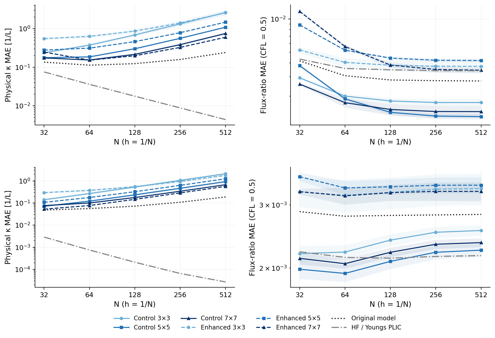

最终收敛图

## 独立圆、椭圆与弱正弦

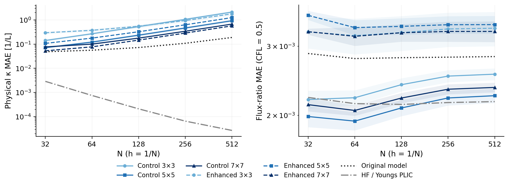

最终收敛图

## 固定物理多项式几何

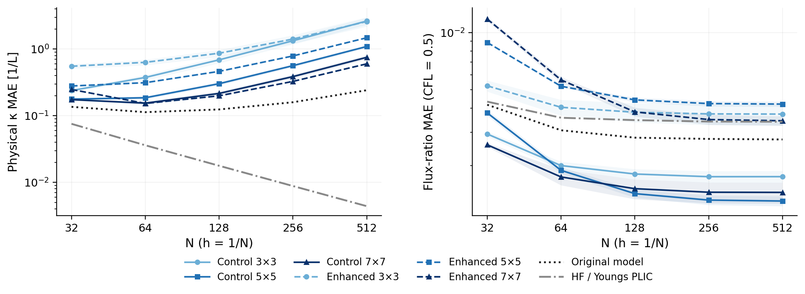

最终收敛图

## 1500步先导 · 数据与邻域对收敛曲线的影响

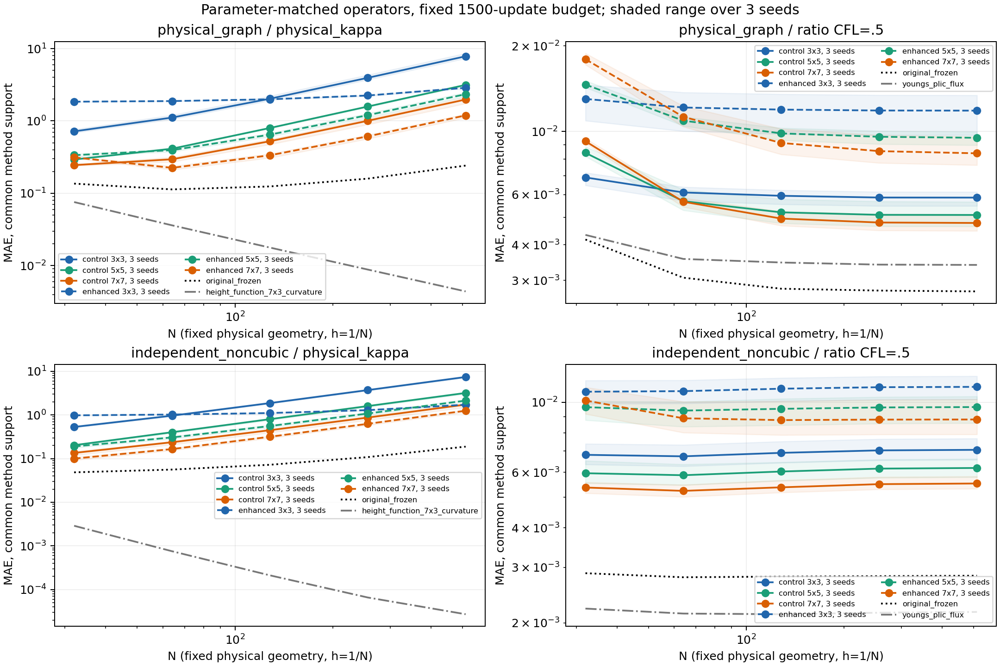

1500步先导收敛图

## 1500步先导 · 原模型的网格收敛

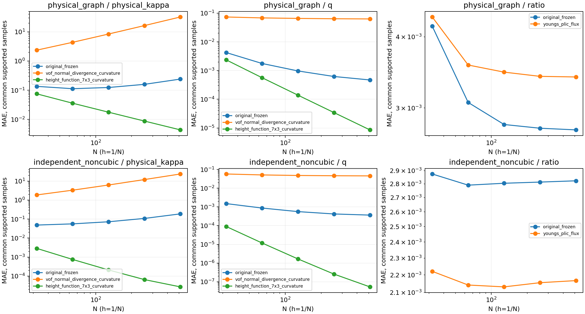

1500步先导收敛图

## 单步精度与延迟：N128，批量4096

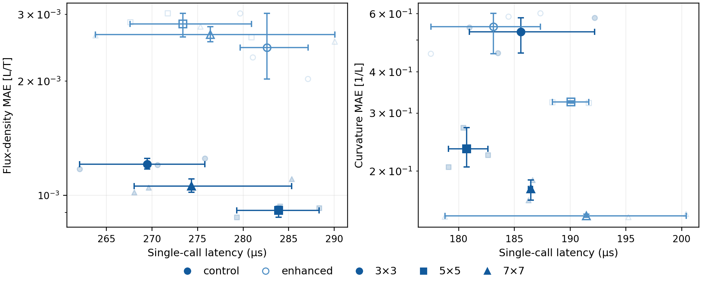

Pure neural operator accuracy versus completed single-call latency after 12000 training steps. Independent circle/ellipse/weak-sine fixture suite; N=128, batch=4096, all_methods_common support (accuracy samples=[2312], eligible=[2688]). Left: face-average flux-density MAE at u=1 and CFL=0.5. Right: physical curvature MAE. RTX5090 / ONNX Runtime CUDAExecutionProvider, native artifact arithmetic with float32 inputs and TF32 disabled; explicit nonzero common CUDA stream. Timing boundary is CUDA-ready input to completed CUDA output, measured by host wall clock; no IO, transfer, stencil extraction or PDE advancement. Each large marker is the mean over all three paired seed models; bars span their observed seed minima/maxima in both error and per-model median wall latency, and faint points retain individual seeds. Filled control and hollow enhanced; circle/square/triangle encode 3/5/7 stencils. This is a discrete same-device NN comparison. CPU float64 conventional references are separately reported and no production-numerical speedup is inferred.

## 单步精度与延迟：批量1

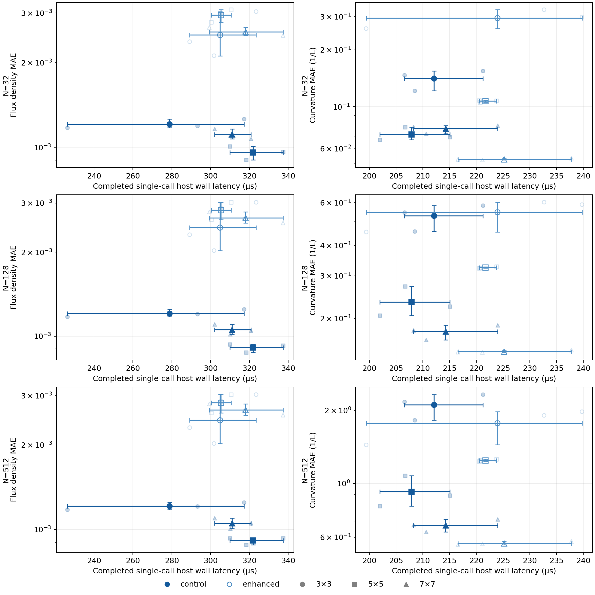

12000-step extended models, independent circle/ellipse/weak-sine fixtures, all_methods_common support. Rows N=32,128,512; columns flux face-average density MAE at CFL=0.5 (u=1), and physical curvature MAE. CUDA RTX5090 single-operator inference, batch=1; host wall boundary CUDA-ready inputs to completed CUDA output. Control/enhanced policies use distinct colors (filled/hollow in the final extended figure); circle/square/triangle are 3/5/7 stencils. Faint markers retain each of three seeds; large markers are seed means and bars show seed range. No full-PDE or optimized numerical production speedup is claimed.

## 单步精度与延迟：批量4096

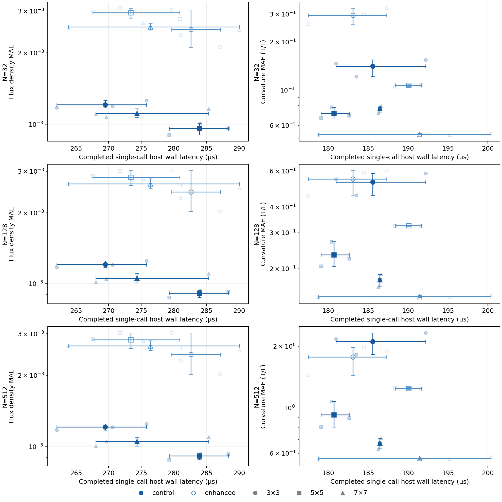

12000-step extended models, independent circle/ellipse/weak-sine fixtures, all_methods_common support. Rows N=32,128,512; columns flux face-average density MAE at CFL=0.5 (u=1), and physical curvature MAE. CUDA RTX5090 single-operator inference, batch=4096; host wall boundary CUDA-ready inputs to completed CUDA output. Control/enhanced policies use distinct colors (filled/hollow in the final extended figure); circle/square/triangle are 3/5/7 stencils. Faint markers retain each of three seeds; large markers are seed means and bars show seed range. No full-PDE or optimized numerical production speedup is claimed.

## 1500步先导 · 单步精度与延迟：批量1

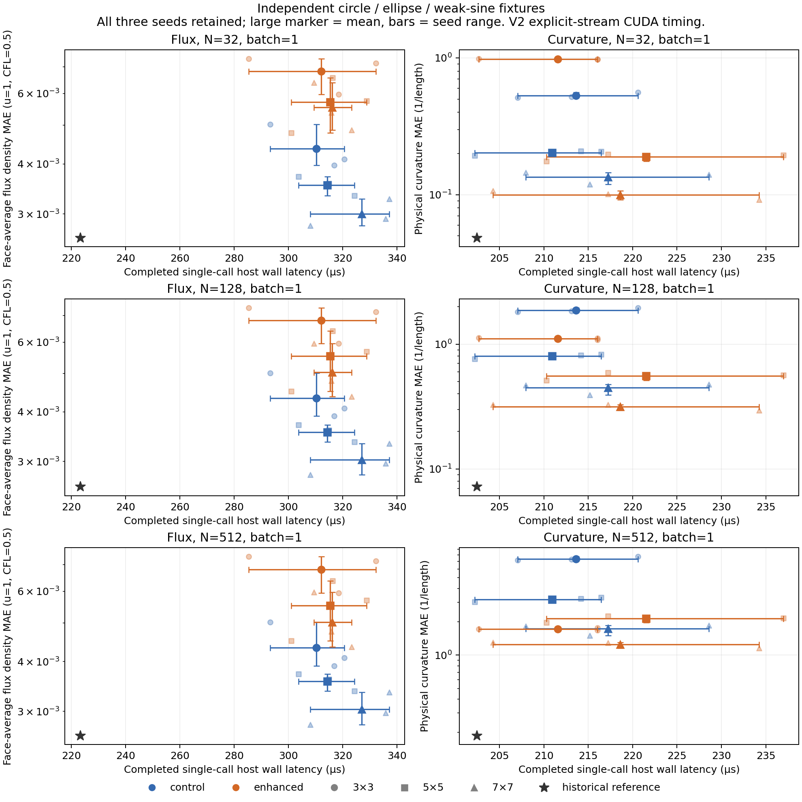

1500步先导推理图

## 1500步先导 · 单步精度与延迟：批量4096

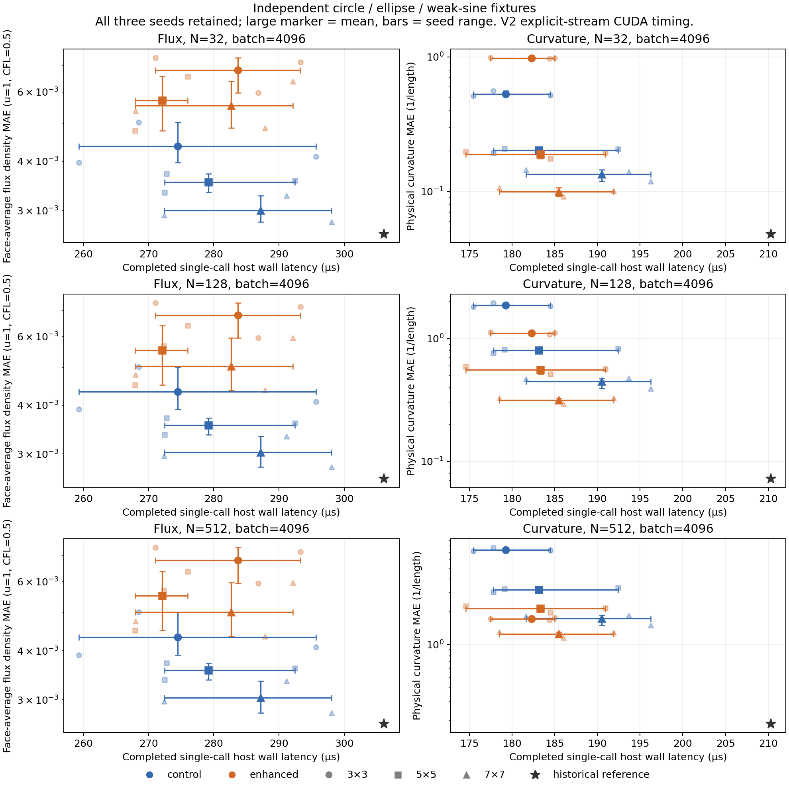

1500步先导推理图

## 传统算子的独立CPU参考

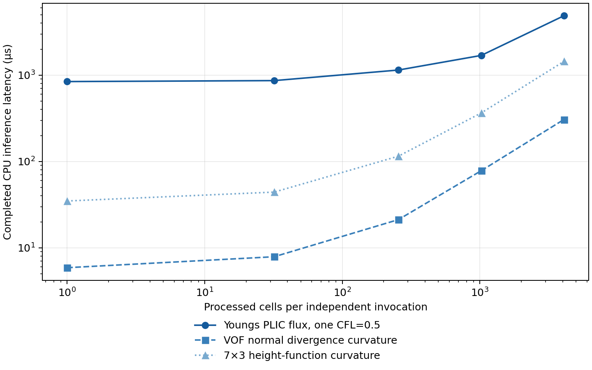

Independent numerical-reference resource layer: CPU Intel Core Ultra 7 270K Plus, one pinned logical core, NumPy 1.26.4 float64; CPU-ready inputs to completed CPU output, 40 warmups and 500 timed invocations. Blue curves are three independent conventional operators; flux evaluates one CFL=0.5 output. Input extraction, IO, dtype conversion, host/device transfers, PDE and NN evaluation are excluded. All outputs/support exactly match the frozen study01 definitions. This is an unoptimized Python/NumPy reference and cannot establish a fair speedup over optimized production numerical methods; it is not merged with CUDA NN winners.
