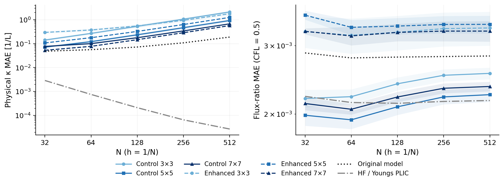
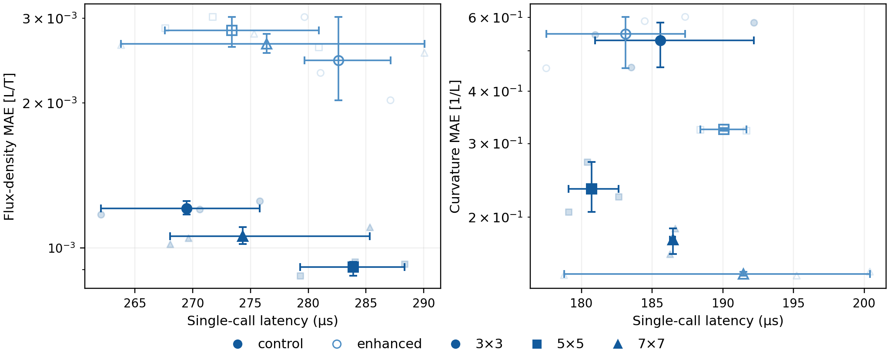

# 三组纯神经算子消融：最终结果

三组实验已完成。通量有可用的精度收益；扩大邻域明显改善新曲率模型，但本轮曲率模型仍未赶上成熟原模型，也没有解决细网格收敛问题。

实验覆盖通量与曲率、两种数据策略、3×3／5×5／7×7邻域和三个配对种子，共36组模型。各组先训练1500步，再依据验证集仍在明显改善的诊断，统一继续到12000步；两个阶段分别保存。最终比较采用12000步阶段。所有神经候选均直接读取体积分数邻域，通量另读Courant数；保留同一代数容量约束，不使用几何高度先验或几何修正。

测试使用31360个冻结物理几何采样，网格N=32、64、128、256、512。除多项式几何外，还包含训练未用的圆、椭圆与弱正弦界面。比较采用跨网格及传统高度函数有效范围的共同样本交集；全部门控与覆盖率结果另行保留。

## 网格加密能否带来收敛？

目前没有得到所期待的物理算子收敛。通量比例和面平均通量密度误差在细网格出现平台；曲率的无量纲误差q变小，换回物理曲率κ=q/h后，误差仍在细网格升高。原模型对平面存在约0.000387的固定q偏置，因此平面的物理曲率误差会随1/h放大。不能用q下降，或输运面积自带的h²缩放，代替物理精度收敛。

## 同样推理时间下，能否更准确？

下表固定独立圆／椭圆／弱正弦测试集、N=128、共同有效样本。误差为三个种子的均值±样本标准差。延迟为RTX 5090上一次批量4096个邻域的完整算子调用：先取各模型重复测量的中位数，再报告三个种子的均值±标准差。输入已在GPU，输出已完成；不包含模拟器、邻域提取、传输或I/O。

| 数据与邻域 | 通量密度MAE [10⁻³ L/T] | 通量延迟 [µs] | 物理曲率MAE [1/L] | 曲率延迟 [µs] |
|---|---:|---:|---:|---:|
| 对照数据 3×3 | 1.209 ± 0.039 | 269.5 ± 6.9 | 0.529 ± 0.065 | 185.6 ± 5.9 |
| 对照数据 5×5 | 0.912 ± 0.032 | 283.9 ± 4.5 | 0.234 ± 0.034 | 180.7 ± 1.8 |
| 对照数据 7×7 | 1.057 ± 0.045 | 274.3 ± 9.6 | 0.177 ± 0.012 | 186.5 ± 0.2 |
| 增强数据 3×3 | 2.452 ± 0.511 | 282.6 ± 4.0 | 0.548 ± 0.082 | 183.1 ± 5.1 |
| 增强数据 5×5 | 2.834 ± 0.205 | 273.4 ± 6.8 | 0.324 ± 0.002 | 190.1 ± 1.6 |
| 增强数据 7×7 | 2.657 ± 0.123 | 276.4 ± 13.2 | 0.146 ± 0.002 | 191.5 ± 11.3 |

通量从3×3扩大到5×5，误差降低24.5%，平均中位延迟从269.5增至283.9 µs，增加5.3%。按300 µs的中位延迟预算，两者都在预算内，5×5更准确。若把误差目标定为0.001，5×5达到目标，3×3未达到，后者的等精度速度比记为未达到。

曲率从3×3扩大到7×7，误差降低66.6%，平均中位延迟约185.6与186.5 µs。在200 µs中位延迟预算内，扩大邻域能提高新模型的精度。把新3×3的误差减半作为目标时，5×5可以达到，平均中位延迟约180.7 µs。重复测量区间明显重叠，小幅时间差不足以证明稳定加速；预算也不是每次调用的最坏延迟保证。

这些结论针对相同设备上的匹配新模型。传统Youngs PLIC、体积分数梯度曲率与高度函数另有CPU NumPy双精度参考计时，设备、精度和实现层次单独标明；本轮没有证明相对优化生产数值代码的同设备加速。

## 改数据与扩大邻域，各自起了什么作用？

扩大邻域确有作用，但收益不随宽度单调增加。通量通常5×5比7×7更合算；曲率7×7明显好于匹配的新3×3。不过，本轮所有聚合物理曲率结果仍差于成熟原神经模型和传统高度函数。例如上述N=128独立测试中，原模型曲率误差为0.0722，传统高度函数约0.000211，新对照数据7×7约0.1768，增强数据7×7约0.1463。

这次增强数据增加了弱曲率、近轴向和平面附近样本，效果并不普遍：通量在两个测试集、五档网格和三种邻域的全部30个组合中，三个种子都变差。曲率只有7×7在N=128和512的两个测试集中表现为三个种子都改善；5×5反而变差，3×3不稳定。因此不能把“更多平面／小曲率数据”当成通用改进，通量与曲率需要分别判断。

归因以同预算、参数匹配的新3×3／5×5／7×7为依据。成熟原模型的编码结构、训练过程和部分约束不同，新模型超过原模型的通量结果不能全部归因于邻域宽度。所有种子和负结果均保留。

## 图与完整结果

图1：独立圆、椭圆与弱正弦界面的共同支持样本；左为物理曲率，右为通量比例误差。实线为对照数据，虚线为增强数据，浅至深蓝对应3×3、5×5、7×7；阴影为三个种子间±1标准差。传统方法作为独立比较。

图2：独立几何、N=128、每次4096个邻域。左为面平均通量密度误差（u=1、CFL=0.5），右为物理曲率误差。实心为对照数据，空心为增强数据；圆、方、三角分别为3×3、5×5、7×7。大点为三个种子均值，浅色小点保留各个种子，误差棒为种子间最小至最大值。横轴为输入已在GPU至输出完成的单次调用延迟，各模型取重复测量中位数；不含模拟器其他组件。

- [全部网格、平面与弱曲率的可读精度表](tables/all-accuracy.html)
- [单步推理计时汇总](tables/final-timing-latency_summary.csv)
- [等时与等精度比较例子](index.html#cost)
- [独立CPU传统算子参考](tables/cpu-reference-accuracy_time_reference.csv)
- [最终训练验证诊断](tables/final-validation-validation_summary.csv)

最终训练预算为每组12000次更新。最后2000步的验证误差改善中位数约2.5%，仍有部分模型在末尾选中最佳权重，因此本报告给出该统一预算下的结果，不把它表述为纯神经方法或邻域大小所能达到的精度上限。首轮1500步结果、继续训练过程与修正前的计时尝试另存。
