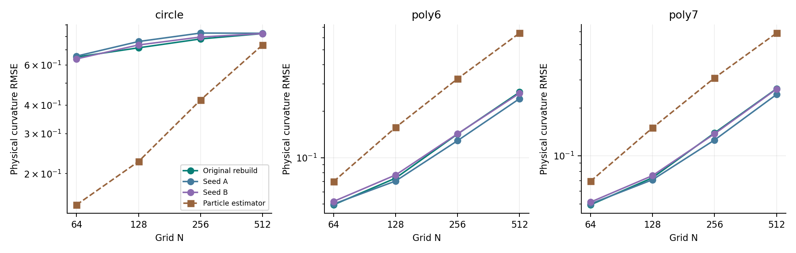
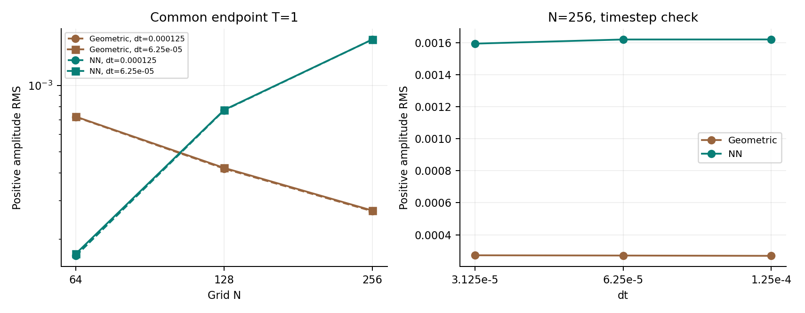
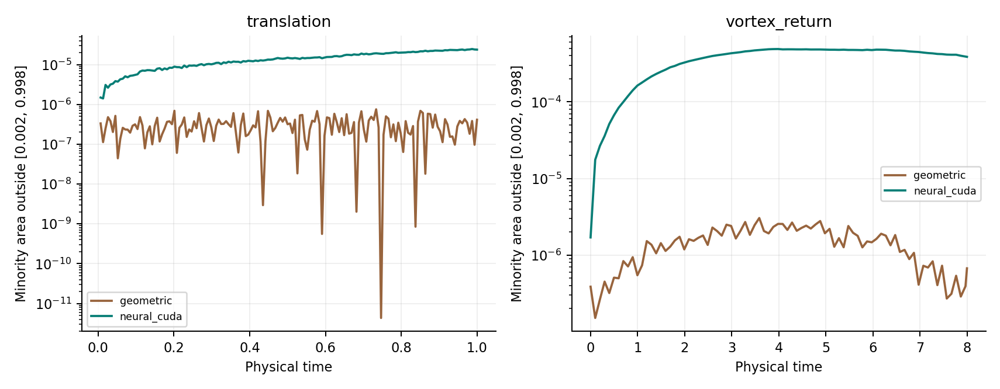
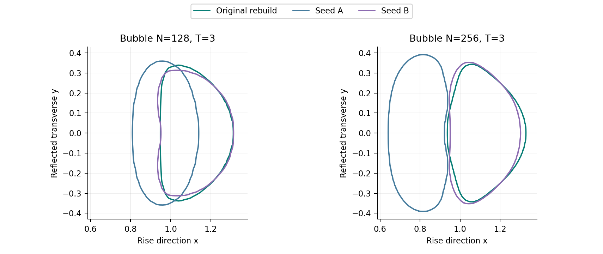
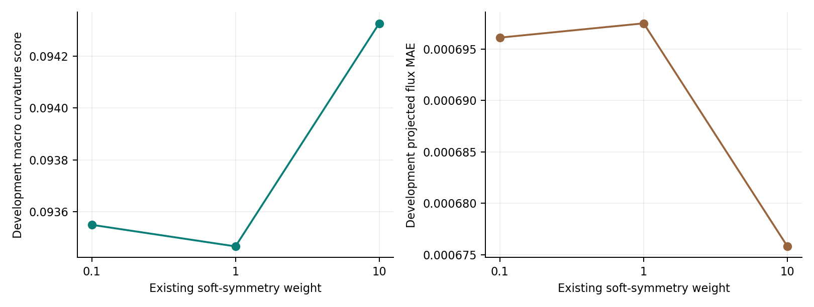
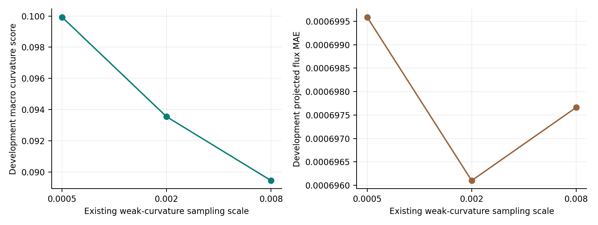
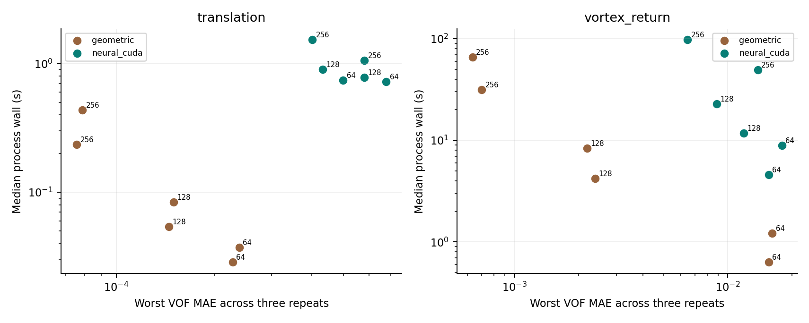

# PLIC-VOF 补充实验

完成时间（UTC）：2026-11-05T15:45:59.669324+00:00。所有新增结果独立保存，原 Overleaf 方法与历史实验不被覆盖。

## 本轮主要发现

相同原课程的三个训练实例在 128 网格毛细波上的正幅值 RMS 为 0.000521386—0.00323382，相差约 6.20 倍。局部曲率平均误差较接近，也可能伴随明显的动力学差异。

256 网格追加一次时间步减半后，神经终态 VOF 差仍约 6.18e-4，传统对照约 5.67e-7；本轮没有获得稳定细网格收敛的证据。

采样尺度 0.008 的旧开发集综合曲率分改善约 4.38%，低于本轮预定的 5% 晋级门槛。两个采样分支均未通过综合门槛，未追加候选动力学；所有分支的封存测试结果保留。

当前两项被动输运中，几何方法在共同误差目标下的进程用时更少。该结果单列于界面方法的比较，原同模型压力后端收益仍按已有配对证据解释。

本轮保持二维、3×3 原始体积分数、共享骨干、64 个正通量分箱、容量限制、0.002 门控、κh 定义及原求解流程。两组完整重训只改变随机种子；探索分支分别共同缩放原文已有的三项软对称损失权重，或改变原 weak 阶段的采样尺度。

## 完成范围

封存 1,800 个新几何模板，另加 5,400 个精确旋转派生样本；64 个固定物理几何曲率场；14 项长时毛细波配置；两组完整原课程重训；21 项多种子及候选物理观测（含复用基线）；3 组软约束权重对照、2 组采样尺度对照；72 条正式被动输运计时，覆盖 24 个配置。

## 曲率与局部算子

传统与神经曲率在完全相同的可用样本上评分，同时保留全部混合格结果。物理形状逐网格重新积分；不把固定模板乘以 1/h 的单位换算当作空间收敛。旋转样本共用基础几何，不能当作额外独立样本。原始通量、容量投影、近纯旁路分别评分；本轮没有新增推理时硬对称修正或几何 fallback。

## 时间步与网格分离

初始矩阵为相同 T=1 下的 3 个网格 × 2 个时间步 × 2 条原始 pipeline。256 网格出现明显时间步敏感性后，仅追加一档更小时间步的两方法对照。所有初始与追加结果均保留；不重复缩小时间步直到得到有利趋势，也不拟合未经支持的收敛阶。参考只提供正幅值，未杜撰相位真值。

| N | dt | 方法 | 正幅值 RMS |
|---:|---:|---|---:|
| 64 | 6.25e-05 | 传统 | 0.00072228 |
| 64 | 6.25e-05 | 神经 | 0.000172212 |
| 64 | 0.000125 | 传统 | 0.000719511 |
| 64 | 0.000125 | 神经 | 0.000168428 |
| 128 | 6.25e-05 | 传统 | 0.000422633 |
| 128 | 6.25e-05 | 神经 | 0.00077513 |
| 128 | 0.000125 | 传统 | 0.000419414 |
| 128 | 0.000125 | 神经 | 0.000772254 |
| 256 | 3.125e-05 | 传统 | 0.000272003 |
| 256 | 3.125e-05 | 神经 | 0.00159336 |
| 256 | 6.25e-05 | 传统 | 0.000270537 |
| 256 | 6.25e-05 | 神经 | 0.00161928 |
| 256 | 0.000125 | 传统 | 0.000268571 |
| 256 | 0.000125 | 神经 | 0.00161959 |

## 尾迹与质量收支

记录快照前后的原生终态逐位一致。平移全时段采用解析圆盘单元平均真值；反转涡旋只在返回时刻采用圆盘真值。混合格数、门控外少数相面积、全场误差、全局面积漂移及网络工作量分别保存。全局守恒很小的误差不能代替界面清晰度；这些时序也不能单独证明某一个机制是全部尾迹的原因。

## 多种子复现

两组新增模型各完成 bootstrap 60 epoch 与原 13 阶段课程。归档数据、网络、损失、学习率和采样配置不变，几何分组验证仍按各自种子进行；模型只按训练验证集选 checkpoint。这里的变化同时包括初始化、抽样和验证分组，不是单独隔离某一种随机性。历史论文原冻结权重仍缺，本轮不冒充历史模型。

| 模型 | 场景 | N | 指标 | 数值 |
|---|---|---:|---|---:|
| baseline | static | 128 | relative Laplace jump error | 0.0517362 |
| baseline | wave | 64 | positive amplitude RMS | 0.000168768 |
| baseline | wave | 128 | positive amplitude RMS | 0.000764459 |
| baseline | bubble | 128 | centroid RMSE to MooNMD numerical benchmark | 0.0104891 |
| baseline | bubble | 256 | centroid RMSE to MooNMD numerical benchmark | 0.0198628 |
| 202611051 | static | 128 | relative Laplace jump error | 0.0420981 |
| 202611051 | wave | 64 | positive amplitude RMS | 0.000418618 |
| 202611051 | wave | 128 | positive amplitude RMS | 0.00323382 |
| 202611051 | bubble | 128 | centroid RMSE to MooNMD numerical benchmark | 0.0510617 |
| 202611051 | bubble | 256 | centroid RMSE to MooNMD numerical benchmark | 0.131839 |
| 202611052 | static | 128 | relative Laplace jump error | 0.0380517 |
| 202611052 | wave | 64 | positive amplitude RMS | 0.00045823 |
| 202611052 | wave | 128 | positive amplitude RMS | 0.000521386 |
| 202611052 | bubble | 128 | centroid RMSE to MooNMD numerical benchmark | 0.00793132 |
| 202611052 | bubble | 256 | centroid RMSE to MooNMD numerical benchmark | 0.0132217 |
| baseline | translation | 128 | VOF MAE to exact cell averages | 0.000579147 |
| baseline | vortex_return | 128 | VOF MAE to exact cell averages | 0.0118395 |
| 202611051 | translation | 128 | VOF MAE to exact cell averages | 0.000551239 |
| 202611051 | vortex_return | 128 | VOF MAE to exact cell averages | 0.00488029 |
| 202611052 | translation | 128 | VOF MAE to exact cell averages | 0.000856247 |
| 202611052 | vortex_return | 128 | VOF MAE to exact cell averages | 0.0175448 |

气泡另列质心、升速和圆度。bubble_shape.csv 同时保存原全混合格 PLIC 圆度及镜像 VOF=0.5 闭合轮廓圆度，后者使用反射后的 VOF 面积与轮廓总周长；轮廓多边形面积与闭合数另列。0.5 轮廓是网格上插值的指标诊断，没有替换原预算或充当精确界面。

## 小型改进探索

三项已有软约束的权重共同取 0.1、1、10，其余最终 weak 阶段、初始模型和训练种子一致。只用旧开发集筛选：综合分为 199 场各自 RMSE/max(参考曲率 RMS, 1) 的均值，使用原基准域单位；该分至少改善 5%，且投影通量 MAE 不恶化超过 5%。封存补充集不参与选择。没有分支达到预设门槛，因此不替换默认模型；三个分支的封存测试均保留。

## 原采样尺度的补充探索

仅改变原 weak 阶段已有的采样尺度：0.0005、0.008，控制值 0.002。网络、损失公式和推理约束保持原样；按同一旧开发集门槛选择，封存集不参与选择。两个分支均未通过门槛，因此本轮未触发候选的额外动力学观测。正式成本矩阵仍对应原冻结模型，不推断采样候选的速度优势。

## 匹配误差目标的成本

正式阶段在本轮训练和并行诊断全部结束后单进程运行，绑定相同两个逻辑 CPU，轮换方法顺序，各三次。几何路径为 CPU，神经路径额外使用 RTX 5090，因此这里是已声明资源组合的部署成本比较。进程墙钟包括启动、模型加载与输出；推进另列。全部重复必须满足主误差和终态面积漂移预算才进入目标选择，不插值或外推未测量的速度。范围不是置信区间；外部进程未被停止，不宣称显卡独占或完整能耗测量。

| 场景 | MAE 目标 | 方法 | 达标 | N / CFL | 进程中位数 s |
|---|---:|---|---|---|---:|
| translation | 0.005 | geometric | 是 | 64 / 0.125 | 0.0286055 |
| translation | 0.005 | neural_cuda | 是 | 64 / 0.125 | 0.725652 |
| translation | 0.002 | geometric | 是 | 64 / 0.125 | 0.0286055 |
| translation | 0.002 | neural_cuda | 是 | 64 / 0.125 | 0.725652 |
| translation | 0.001 | geometric | 是 | 64 / 0.125 | 0.0286055 |
| translation | 0.001 | neural_cuda | 是 | 64 / 0.125 | 0.725652 |
| vortex_return | 0.05 | geometric | 是 | 64 / 0.125 | 0.631802 |
| vortex_return | 0.05 | neural_cuda | 是 | 64 / 0.125 | 4.60284 |
| vortex_return | 0.02 | geometric | 是 | 64 / 0.125 | 0.631802 |
| vortex_return | 0.02 | neural_cuda | 是 | 64 / 0.125 | 4.60284 |
| vortex_return | 0.01 | geometric | 是 | 128 / 0.125 | 4.20708 |
| vortex_return | 0.01 | neural_cuda | 是 | 128 / 0.0625 | 22.8067 |

## 文件与复现

图表提供 PNG 与 SVG。data/ 保存物理曲率、局部与旋转算子、毛细波、尾迹、多种子物理量、权重筛选和匹配误差成本 CSV；summary.json 汇总完整数字和限制。原始场、训练 checkpoint、命令、源码摘要及逐配置记录保存在本机 experiment-supplement-20261105 的各实验目录。网页提供指标、图表与汇总数据。

对应入口为 agent_experiments/supplement_training.py、supplement_resident_train.py、supplement_geometry.py、supplement_wave.py、supplement_wave_followup.py、supplement_passive.py、supplement_refinement.py、supplement_finish.py。完整课程与原生二进制复用本工作区已归档输入；不要删除历史目录或覆盖冻结记录来重新开始。

加载加速只改变数据驻留和指标累计。16 个小批次的参数与损失逐位一致；该小试验受并行背景和启动开销影响，不能把它的时间比当作完整训练或流体模拟的加速倍数。原加载方式的未完成尝试已保留，未参与正式成本结论。
